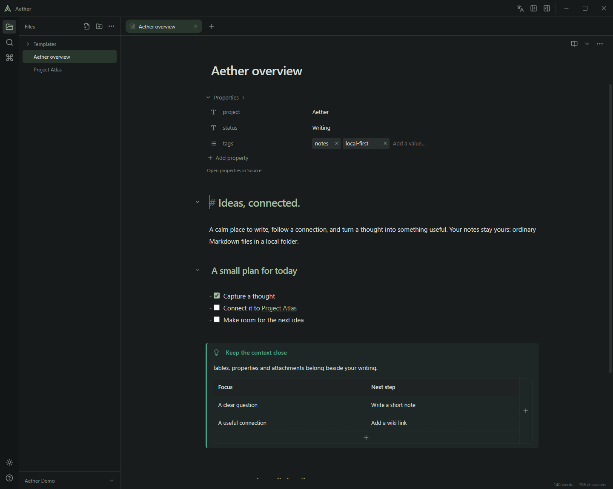
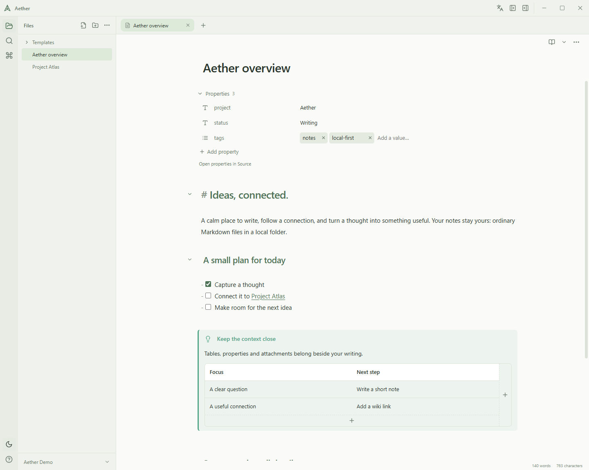
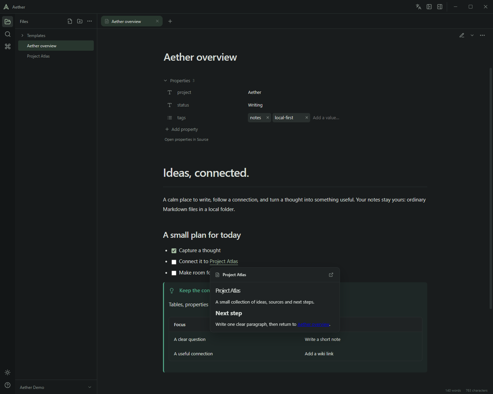
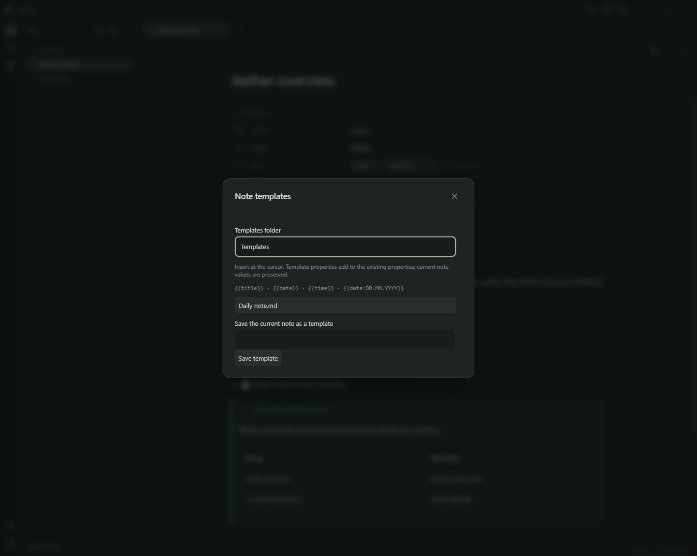

# Aether

**A calm, local workspace for connected notes.** Write in Markdown, keep supporting material beside your ideas, and follow links without losing your place. Your vault is an ordinary folder. No account or cloud service is required.

[Русский](README.ru.md) · [Documentation](docs/README.md) · [Contributing](CONTRIBUTING.md)

[](https://github.com/d0rsett/aether/actions/workflows/checks.yml)

[](https://v2.tauri.app/)
[](https://react.dev/)
[](https://www.typescriptlang.org/)
[](https://www.rust-lang.org/)
[](https://codemirror.net/)
[](https://vite.dev/)



## Write, connect, keep control

- **Three ways to work:** Source, Live Preview and Reading. Switch modes without losing drafts or editing history. Fold headings and lists; use the command palette, formatting tools and templates.
- **Connected notes:** wiki links, aliases, heading and block references, suggestions, backlinks and previews of linked notes, including unsaved open buffers.
- **Editing inside the note:** Markdown tables with row/column controls and right-click actions; YAML properties with type icons, lists, suggestions and renaming.
- **Rich content:** note embeds, images, audio/video players, PDF search and selectable text, password prompts and read-only annotations, callouts, named/inline footnotes, KaTeX and Mermaid.
- **Your workspace:** tabs, resizable sidebars, light/dark themes, English/Russian interface and full-text search with path, tag and property filters.
- **Recoverable file operations:** explicit, revision-checked saves; drafts; moves and renames that update supported links; operation journals with Undo; vault-local trash.

## Obsidian vaults

Open an existing vault folder directly. Aether reads ordinary Markdown and attachments, supported wiki/Markdown links, aliases, heading/block targets, attachment preferences, template folder settings and vault-wide property types. Changing a property type explicitly updates its entry in Obsidian's type settings while preserving unrelated fields. Notes are saved only when you request it.

Compatibility is incremental: Aether does not run Obsidian community plugins, Bases or Canvas. Complex YAML can remain source-only; arbitrary HTML scripts, web-page embeds and executable PDF actions are restricted. See [compatibility and writing](docs/interface.md) for boundaries.

## A closer look

| Light theme                                                     | Linked-note preview                                                  |
| --------------------------------------------------------------- | -------------------------------------------------------------------- |
|  |  |



Screenshots use synthetic notes and the actual English interface. The [Russian edition](README.ru.md) has Russian interface and note screenshots.

## Run and build

[Download Aether 0.2.0 for Windows](https://github.com/d0rsett/aether/releases/tag/v0.2.0) · [Changelog](CHANGELOG.md)

Version **0.2.0**, early development. **Windows is the tested platform**; macOS/Linux are unvalidated. Running a built application requires Microsoft Edge WebView2 Runtime. There is no configured automatic updater or signed release pipeline; performance targets have not been benchmarked.

For development install Node.js **22.12+** (CI uses 24), Rust **1.90+**, Visual Studio Build Tools with Desktop development with C++, and the Windows SDK.

```powershell
npm ci
npm run tauri -- dev
```

Build an ordinary executable without installers:

```powershell
npm run tauri -- build --no-bundle
```

Output: `src-tauri/target/release/aether.exe`. To build the configured Windows installer, run `npm run tauri -- build`; bundles appear under `src-tauri/target/release/bundle/`. Node and Rust are not needed to run a built application. Keep a running application's executable intact; use a separate target directory if it is locked.

## Everyday controls

Open or create a vault from the welcome screen or the vault menu. Use the globe/language icon near the window controls to switch English/Russian; the choice persists locally. Markdown content, filenames and property names are never translated.

| Shortcut        | Action                   |
| --------------- | ------------------------ |
| Ctrl+S          | Save the current note    |
| Ctrl+P          | Open the command palette |
| Ctrl+Shift+F    | Search the vault         |
| Ctrl+B / Ctrl+I | Bold / italic            |
| Ctrl+Z / Ctrl+Y | Undo / redo              |

Use the note menu for modes, line numbers and the formatting toolbar. Hover a supported internal link to preview its target. Right-click a table cell for table actions; use the plus controls to add rows and columns. Click a property's type icon to choose its vault-wide type. Use **Insert template** in the command palette for templates.

## Files and privacy

Markdown and attachments remain in the vault. The disposable SQLite index and app settings live in application data. WebView storage keeps interface preferences, per-vault sessions and recovery drafts. Rename journals and recoverable deletions live under the vault's `.aether/` directory. Drafts and trash are not backups.

External images and media load only on request; regular web links open in the browser. Core writing, navigation and search work locally. Keep personal vaults outside the repository or inside ignored `vaults/`; never publish local profiles or note content.

## Development and documentation

```powershell
npm test
npm run build
npm run format:check
npm run repo:check
cargo test --locked --manifest-path src-tauri/crates/aether-core/Cargo.toml
```

[Architecture](docs/architecture.md) · [Interface and compatibility](docs/interface.md) · [Knowledge API](docs/knowledge-api.md) · [Live Preview internals](docs/live-blocks.md) · [Native testing and screenshots](docs/native-testing.md)

Technology badges show selected lockfile versions or stated tool requirements, not the latest available releases. Other rendering libraries include KaTeX 0.19.1, Mermaid 12.2.0 and PDF.js 6.4.299. No project license has been selected.
