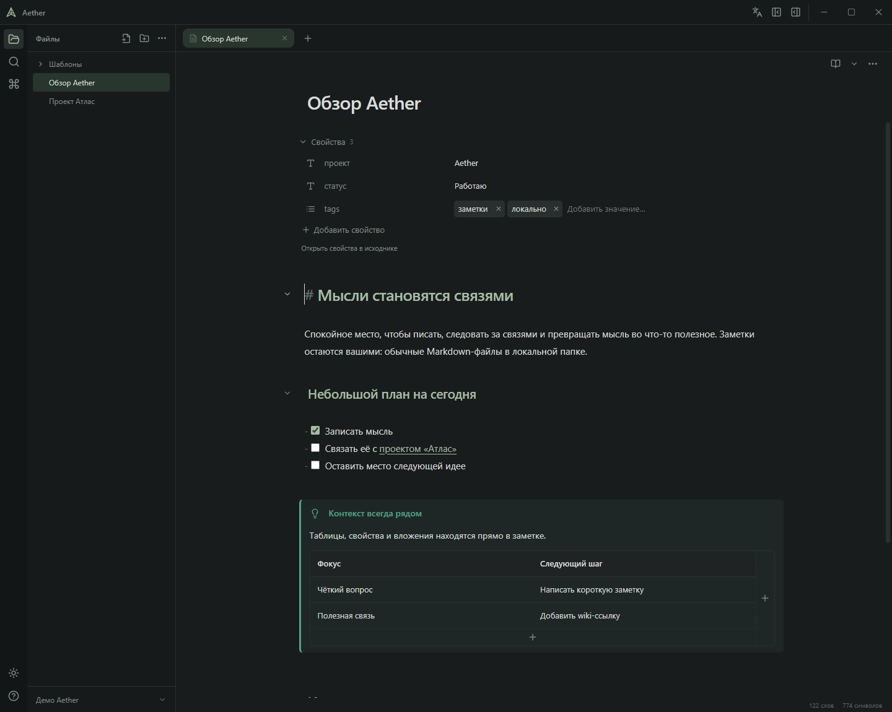
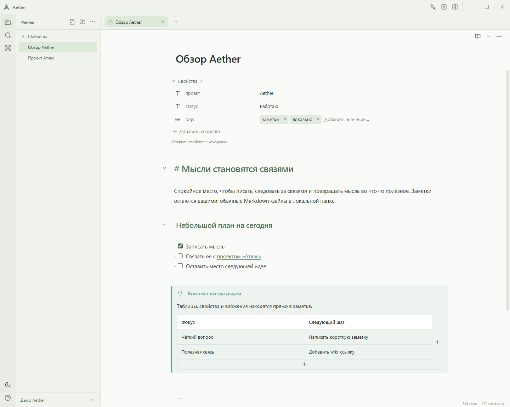
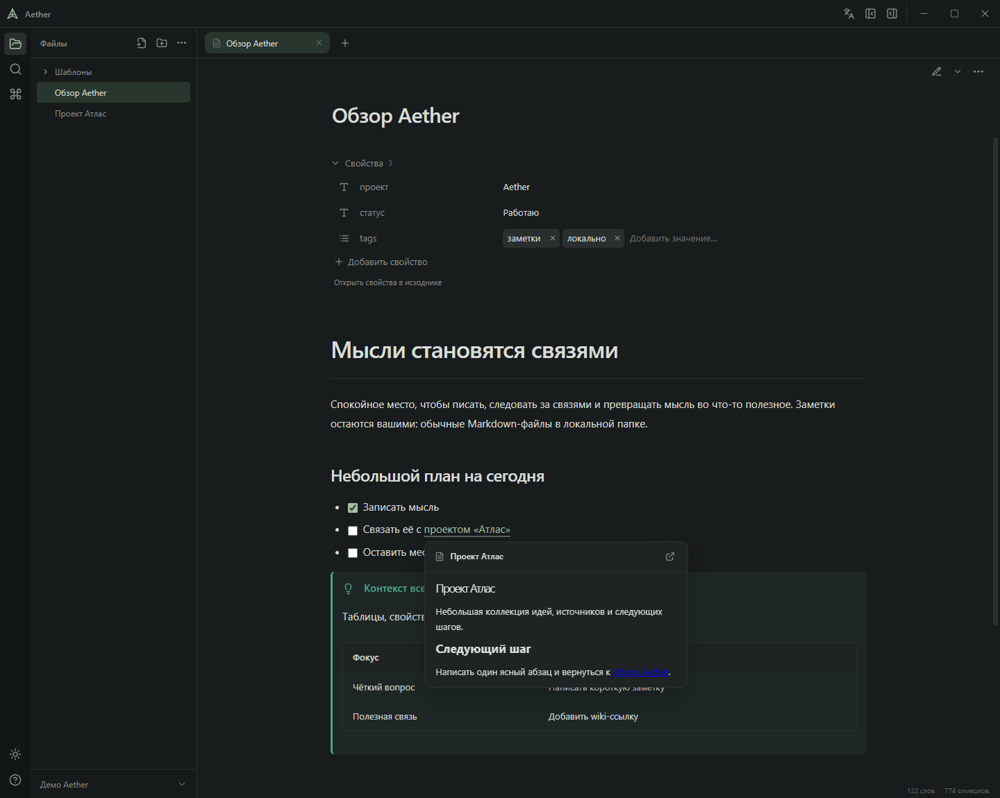
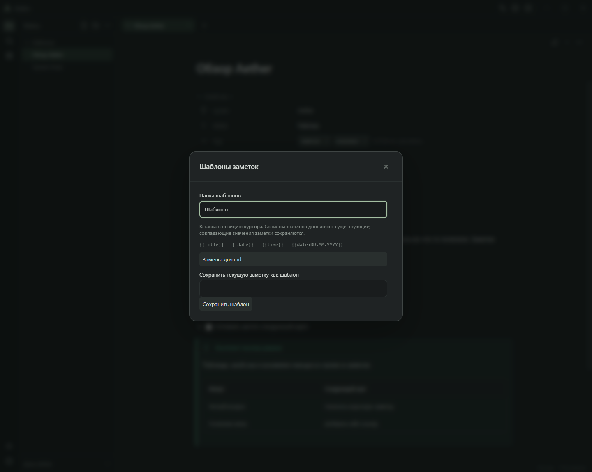

# Aether

**Спокойное локальное пространство для связанных заметок.** Пишите в Markdown, держите материалы рядом с мыслями и переходите по связям, не теряя контекст. Хранилище — обычная папка. Аккаунт и облачный сервис не нужны.

[English](README.md) · [Документация](docs/README.ru.md) · [Участие в разработке](CONTRIBUTING.ru.md)

[](https://github.com/d0rsett/aether/actions/workflows/checks.yml)

[](https://v2.tauri.app/)
[](https://react.dev/)
[](https://www.typescriptlang.org/)
[](https://www.rust-lang.org/)
[](https://codemirror.net/)
[](https://vite.dev/)



## Писать, связывать, управлять своими файлами

- **Три режима:** исходник, Live Preview и чтение. Переключайтесь без потери черновиков и истории правок. Сворачивайте заголовки и списки, используйте палитру команд, форматирование и шаблоны.
- **Связанные заметки:** wiki-ссылки, псевдонимы, ссылки на заголовки и блоки, подсказки, обратные ссылки и предпросмотр связанных заметок, включая несохранённый текст открытых вкладок.
- **Редактирование внутри заметки:** Markdown-таблицы с добавлением строк/столбцов и действиями по ПКМ; YAML-свойства с иконками типов, списками, подсказками и переименованием.
- **Материалы рядом:** встроенные заметки, изображения, аудио и видео, поиск и выделение текста в PDF, ввод пароля и просмотр аннотаций, выноски, именованные и встроенные сноски, KaTeX и Mermaid.
- **Рабочее пространство:** вкладки, изменяемые боковые панели, светлая/тёмная темы, русский/английский интерфейс и полнотекстовый поиск с фильтрами пути, тегов и свойств.
- **Восстановимые операции:** явное сохранение с проверкой ревизии, черновики, перенос и переименование с обновлением поддерживаемых ссылок, журналы операций с отменой и корзина внутри хранилища.

## Хранилища Obsidian

Открывайте существующую папку напрямую. Aether читает Markdown и вложения, поддерживаемые wiki/Markdown-ссылки, псевдонимы, ссылки на заголовки/блоки, настройки вложений, папки шаблонов и общие типы свойств. Явная смена типа свойства обновляет его запись в настройках Obsidian, сохраняя остальные поля. Заметки сохраняются только по вашему действию.

Совместимость развивается постепенно: Aether не запускает плагины Obsidian, Bases или Canvas. Сложный YAML может требовать исходника; произвольные HTML-скрипты, встраивание веб-страниц и исполняемые действия PDF ограничены. Подробнее — в [описании интерфейса и совместимости](docs/interface.ru.md).

## Как это выглядит

| Светлая тема                                                     | Предпросмотр связанной заметки                                       |
| ---------------------------------------------------------------- | -------------------------------------------------------------------- |
|  |  |



Снимки сделаны с демонстрационными заметками в настоящем русском интерфейсе. В [английской версии](README.md) интерфейс и содержимое снимков на английском.

## Запуск и сборка

Версия **0.1.0**, ранняя разработка. **Проверенная платформа — Windows**; macOS/Linux не проверены. Для готового приложения нужен Microsoft Edge WebView2 Runtime. Автообновление и подписанные релизы не настроены; целевые показатели производительности не измерены.

Для разработки установите Node.js **22.12+** (CI использует 24), Rust **1.90+**, Visual Studio Build Tools с компонентами разработки классических приложений на C++ и Windows SDK.

```powershell
npm ci
npm run tauri -- dev
```

Сборка обычного приложения без установщика:

```powershell
npm run tauri -- build --no-bundle
```

Результат: `src-tauri/target/release/aether.exe`. Для настроенного Windows-установщика запустите `npm run tauri -- build`; пакеты появятся в `src-tauri/target/release/bundle/`. Готовому приложению Node и Rust не нужны. Не заменяйте занятый файл запущенного приложения: используйте отдельную папку сборки.

## Основные действия

Откройте или создайте хранилище на начальном экране либо в меню хранилища. Кнопка языка возле управления окном переключает русский/английский; выбор сохраняется локально. Текст заметок, имена файлов и свойств не переводятся.

| Сочетание       | Действие                  |
| --------------- | ------------------------- |
| Ctrl+S          | Сохранить текущую заметку |
| Ctrl+P          | Открыть палитру команд    |
| Ctrl+Shift+F    | Поиск по хранилищу        |
| Ctrl+B / Ctrl+I | Жирный / курсив           |
| Ctrl+Z / Ctrl+Y | Отменить / повторить      |

В меню заметки доступны режимы, номера строк и панель форматирования. Наведите на внутреннюю ссылку для предпросмотра. ПКМ по ячейке открывает действия таблицы; плюсики добавляют строки и столбцы. Иконка типа свойства открывает выбор общего типа для хранилища. Шаблоны доступны через команду **Вставить шаблон**.

## Файлы и приватность

Markdown и вложения остаются в хранилище. Восстанавливаемый индекс SQLite и настройки находятся в данных приложения. WebView хранит предпочтения, вкладки и черновики восстановления для каждого хранилища. Журналы переименований и удалённые файлы находятся в `.aether/` внутри хранилища. Черновики и корзина не заменяют резервные копии.

Внешние изображения и медиа загружаются по запросу; обычные веб-ссылки открываются в браузере. Основные функции письма, навигации и поиска работают локально. Личные хранилища держите вне репозитория или в игнорируемой папке `vaults/`; не публикуйте профили приложения и содержимое заметок.

## Разработка и документация

```powershell
npm test
npm run build
npm run format:check
npm run repo:check
cargo test --locked --manifest-path src-tauri/crates/aether-core/Cargo.toml
```

[Архитектура](docs/architecture.ru.md) · [Интерфейс и совместимость](docs/interface.ru.md) · [API знаний](docs/knowledge-api.ru.md) · [Устройство Live Preview](docs/live-blocks.ru.md) · [Нативные проверки и снимки](docs/native-testing.ru.md)

Значки показывают выбранные версии из lock-файлов или требования к инструментам, а не последние доступные выпуски. Также используются KaTeX 0.19.1, Mermaid 12.2.0 и PDF.js 6.4.299. Лицензия проекта пока не выбрана.
