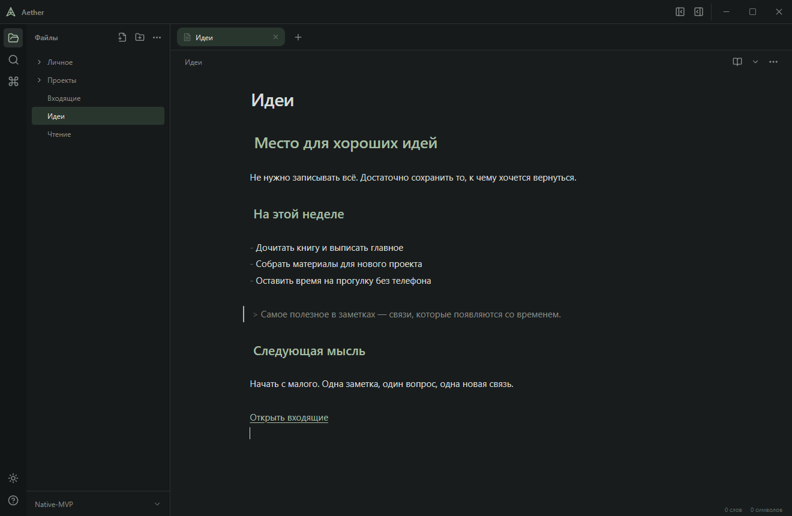

# Aether

**Локальное Markdown-приложение для связанных заметок.** Tauri 2, Rust, React, TypeScript и CodeMirror 6. Заметки остаются обычными файлами в вашей папке. Учётная запись и облачный сервис не нужны.

[English documentation](README.md) · [Архитектура](docs/architecture.ru.md) · [Участие и публикация](CONTRIBUTING.ru.md)



## Статус

Ранняя desktop-версия 0.1.0. **Проверенная платформа — Windows**; сборки macOS/Linux пока не проверены. Интерфейс сейчас на русском. Подписанный установщик и автоматическое обновление не настроены. Численные показатели производительности ещё не измерены.

Прежнее название — **Aether Notes**. Теперь продукт, пакет и исполняемый файл называются **Aether** / `aether`. Внутренний identifier `app.aether.notes`, папка метаданных `.aether` и ключи локального хранилища сохранены для совместимости с настройками и черновиками.

## Возможности

- Открытие и создание хранилищ, переключение между последними 20 папками. Создать хранилище можно и с пустого экрана редактора.
- Дерево вложенных папок с горизонтальной прокруткой, редактированием имён прямо в строке, контекстными меню и открытием файлов/хранилища в Проводнике Windows.
- Прокручиваемые вкладки редактора, крупный редактируемый заголовок, собственная панель окна, регулируемые боковые панели, светлая и тёмная темы.
- Исходный Markdown, Live Preview и чтение; форматирование, таблицы, локальные изображения, формулы KaTeX и диаграммы Mermaid в изолированном iframe. Live Preview раскрывает синтаксис у каретки/выделения в нужном фрагменте или блоке.
- Wiki-ссылки, переходы к заголовкам/блокам, подсказки, входящие/исходящие связи, теги и скалярные YAML-свойства.
- SQLite FTS5: поиск по тексту/имени с фильтрами пути, тега и свойства; watcher обновляет дерево и индекс после внешних изменений.
- Перенос заметок мышью в папки и корень. Перемещения файлов и переименования файлов/папок обновляют поддерживаемые wiki-/Markdown-ссылки, относительные изображения и reference definitions. Короткие wiki-имена остаются короткими, если разрешаются однозначно.
- Сохранение с проверкой ревизии, журнал переименования с отменой/восстановлением, резервирование черновиков, корзина файлов и папок.

## Требования

Для запуска готового EXE нужен **Microsoft Edge WebView2 Runtime**. Node.js, Rust и Vite для запуска собранного приложения не требуются.

Для разработки и сборки на Windows:

- Node.js 22.12+ и npm; в проверках проекта используется Node.js 24.
- Rust stable 1.90+ с Windows MSVC toolchain.
- Visual Studio / Build Tools: **Desktop development with C++**, инструменты MSVC x64/x86 и Windows 10/11 SDK.
- WebView2 Runtime и Git.

Если linker/SDK не найдены, используйте Developer PowerShell. `npm run tauri -- info` показывает обнаруженное окружение. Первичная установка зависимостей/сборка требует сети; само приложение работает офлайн.

## Разработка и сборка

Из корня репозитория:

```powershell
npm ci
npm run tauri -- dev
```

`npm run dev` запускает только предпросмотр UI на `http://127.0.0.1:1420`. Для файловых операций нужен нативный host.

Windows EXE без установщика:

```powershell
npm run tauri -- build --no-bundle -- --locked
```

Результат: `src-tauri/target/release/aether.exe`.

Установщик Windows NSIS:

```powershell
npm run tauri -- build -- --locked
```

Результат: `src-tauri/target/release/bundle/nsis/`. При первой сборке может скачиваться NSIS. Установщики пока без подписи. Другим ОС нужны платформенные зависимости Tauri и соответствующий bundle target; текущая конфигурация рассчитана на Windows NSIS. Сохраняйте `package-lock.json` и оба Cargo lockfile — для host и независимого ядра.

## Работа с приложением

### Хранилища и файлы

Открывайте папку через Ctrl+O или меню хранилища. **Создать хранилище** открывает форму с названием и расположением: путь можно ввести или выбрать через «Обзор». Новая папка создаётся только после нажатия «Создать хранилище». Существующие папки не перезаписываются. Вкладки/черновики разделяются по хранилищам; переключение предупреждает о несохранённой работе.

Плюс в полосе вкладок создаёт `Новая заметка` в корне. Чтобы переименовать её, измените крупный заголовок. Контекстное меню папки создаёт заметки/подпапки внутри неё. Новая папка сразу появляется как `Новая папка` с редактированием имени. При переименовании в дереве Enter или потеря фокуса применяют имя, Escape отменяет ввод. Вводите имя без полного пути; совпадение с существующим именем вызывает ошибку без перезаписи.

Перетаскивайте заметки на папку или область корня. Ссылки обновляются по фактическим Markdown-файлам независимо от кеша. Переименование папки сохраняет вложения и пустые подпапки и обновляет открытые вкладки. Обычное переименование выполняется сразу; в палитре также есть явный предпросмотр. Отмена переименования и восстановление незавершённой операции — отдельные действия. Иногда восстановление необходимо до следующего переименования.

### Сохранение и конфликты

**Ctrl+S записывает исходный файл; автоматическое сохранение Markdown отключено.** Резервный черновик создаётся примерно через 700 мс после ввода и сразу при штатном закрытии/смене хранилища. Восстановленный черновик открывается в редакторе и попадает в исходный файл только после сохранения.

Черновики не заменяют резервное копирование: авария может потерять недавний ввод, хранилище может переполниться, очистка данных WebView удаляет черновики. Внешние изменения не заменяют открытый текст автоматически. При сохранении проверяется ревизия; перечитывание и сохранение копии позволяют разрешить конфликт. Поддерживаемые операции сохранения сохраняют BOM и CRLF.

### Ссылки и отображение

В чтении и Live Preview поддерживаются выделение Obsidian (`==текст==`), однострочные/многострочные комментарии (`%%комментарий%%`) и выноски (`> [!note]`, включая вложенность и сворачивание через `+`/`-`). Комментарии исключаются из индексируемого текста, тегов и ссылок; незавершённый комментарий скрывает остаток основного текста. Исходный режим сохраняет обычную разметку. В Live Preview исходник раскрывается при переходе к фрагменту/блоку или через кнопку редактирования. Выделение использует акцент темы; типы выносок имеют разные иконки и тематические цвета.

Флажки задач переключаются в чтении и Live Preview. Изменения проходят через историю редактора и остаются несохранёнными до Ctrl+S. Устаревший просмотр не может изменить более новый текст.

Таблица вставляется через панель форматирования или контекстное меню редактора. В Live Preview ячейки редактируются прямо в заметке; плюсы снизу и справа добавляют строки и столбцы, а меню по правому щелчку на ячейке позволяет их удалять и перемещать, сортировать строки и менять выравнивание. Правки попадают в буфер и поддерживают отмену; Ctrl+S сохраняет файл. Вне фокуса отображается форматирование Markdown, длинный текст переносится; для явного переноса внутри ячейки используйте `<br>`. Формат остаётся обычным Markdown. Таблицы внутри обычных цитат и списков с одинаковым отступом редактируются с сохранением префиксов; таблицы внутри выносок также редактируются с сохранением префиксов `>`; неоднозначная вложенность и слишком большие таблицы остаются в исходнике (визуальный редактор: 50 столбцов, 5000 ячеек, 256 КиБ).

Именованные сноски (`[^name]` и `[^name]: текст`) в чтении имеют переход к определению и кнопку возврата к последней нажатой ссылке. Встроенные сноски `^[текст]` в чтении открываются по нажатию и поддерживают Markdown внутри; в Live Preview они остаются исходным текстом, как в Obsidian. У встроенных заметок отдельная область переходов. В Live Preview переход раскрывает соответствующее место исходника; позиция возврата сдвигается вместе с правками.

Локальные PDF, аудио и видео встраиваются через wiki- или Markdown-разметку в чтении и Live Preview. Аудио и видео загружаются при приближении к видимой области, PDF — по нажатию. «Скрыть просмотр» освобождает ресурсы. PDF отображается через локальные PDF.js worker и ресурсы шрифтов: страницы рисуются на canvas, есть переходы назад/вперёд и `#page=2&height=400`. Можно выделять и копировать текст, искать по всему документу с переходами к страницам и подсветкой, читать текстовые аннотации страницы и вводить пароль защищённого PDF. Поиск не распознаёт текст на сканах без текстового слоя; создание аннотаций, заполнение форм и XFA не поддерживаются. Для аудио используется плеер в стиле приложения, для видео — стандартные элементы управления; доступность кодеков зависит от WebView2/Windows. Файл должен находиться в хранилище, иметь подходящие расширение/сигнатуру и размер до 64 МиБ; для больших/неподдерживаемых файлов остаётся «Показать файл». Просмотр не переписывает вложения.

В чтении и Live Preview отображается пассивный HTML: оформление текста, заголовки, списки, таблицы, `details`/`summary`, ссылки и локальные изображения. Inline-теги могут окружать Markdown. Скрипты, обработчики событий, CSS, формы, SVG/MathML и другие активные элементы отбрасываются. Внешние изображения и прямые аудио/видео загружаются только по нажатию; страницы iframe открываются в браузере без выполнения в приложении. HTTP(S)-ссылки открываются явным нажатием через существующее действие; локальные ссылки/изображения разрешаются внутри хранилища. В исходном режиме весь оригинальный HTML сохраняется. Это поддерживаемое пассивное подмножество, без полной совместимости с HTML/CSS Obsidian.

Используйте `[[Заметка]]`, `[[Заметка#Заголовок]]`, `[[Заметка#^block-id]]` или `[текст](../Note.md#Heading)`. Ctrl+Space вызывает подсказки. В Source/Live ссылки открываются Ctrl+щелчком, в чтении — обычным щелчком. Отсутствующую wiki-заметку можно создать после подтверждения.

Псевдонимы из YAML `aliases: [ИИ, Artificial Intelligence]` участвуют в подсказках ссылок. Выбор вставляет переносимую ссылку `[[Папка/Настоящее имя|ИИ]]`; одинаковые псевдонимы различаются путями. Уже написанные `[[ИИ]]`, ссылки на разделы/блоки и встраивания тоже разрешаются через `aliases`. Настоящие пути и имена файлов имеют приоритет; несколько подходящих псевдонимов считаются неоднозначной ссылкой. Поддерживаются YAML-списки и одно строковое значение; запятые внутри строки не разделяют имена. Пустые, нестроковые значения и имена с управляющими символами или `[]|#` пропускаются. Изменения псевдонимов становятся доступны после сохранения и индексации; файлы заметок и настройки Obsidian не переписываются.

Свойства отображаются в начале заметки в Live Preview и режиме чтения и редактируют текущий буфер непосредственно в строках. Тип выбирается нажатием на значок слева от имени; выбор сохраняется в `.obsidian/types.json` для всего хранилища, включая уже заданные типы. Встроенные типы `tags`, `aliases`, `cssclasses` защищены от изменения. В исходном режиме виден YAML. Здесь можно добавлять, менять и удалять текст, списки строк, числа, даты, даты со временем и флажки; `tags` и `aliases` редактируются списками, каждое значение — с новой строки. Правки входят в историю редактора и записываются в файл только по Ctrl+S. Незавершённое некорректное значение остаётся в интерфейсе при смене режима, но не попадает в заметку до исправления и хранится только во время работы приложения. Типы читаются из `.obsidian/types.json`, если заданы, иначе определяются по значению; смена типа сохраняет остальные настройки, BOM и переводы строк и отклоняет конфликтующие изменения. Остальные заметки не преобразуются автоматически. Несовместимое значение или неизвестный тип открывается в исходнике без автоматического преобразования. В обычном YAML меняется выбранное поле с сохранением остальных полей, комментариев и тела заметки; flow/JSON-свойства могут переформатироваться внутри шапки. Вложенные объекты, YAML-якоря/ссылки, нестандартные теги, сложные списки и числа за пределами точности редактора доступны через «Открыть свойства в исходнике». При повреждённых настройках/YAML или изменении свойств во время правки правка блокируется с пояснением.

Связи и теги в панели описывают сохранённую/проиндексированную версию, которая может отличаться от черновика. Переходы к заголовкам/блокам умеют использовать текущий буфер. Списки связей ограничены 100 ссылками.

PNG/JPEG/GIF/WebP/BMP и SVG без активного содержимого до 8 МиБ читаются внутри хранилища через `` или `![[path]]`. Изображение открывается крупно по клику; размеры Obsidian `![[image.png|300]]` и `![[image.png|300x200]]` поддерживаются. Внешние растровые изображения загружаются по нажатию (до 8 МиБ). Внешние PDF, аудио и видео загружаются по нажатию до 64 МиБ; загрузка доступна в Windows и проверяет публичные адреса и перенаправления. Mermaid изолирован в iframe; KaTeX ограничивает недоверенный ввод. HTTP(S)-ссылки открываются в системном браузере только по действию пользователя.

В чтении и Live Preview встраивания показывают содержимое заметок: `![[Заметка]]`, `![[Заметка#Заголовок]]`, `![[Заметка#Родитель#Дочерний]]`, `![[Заметка#^block]]`, а также Markdown-встраивания вида ``. Раздел включает подразделы до следующего заголовка того же или более высокого уровня. Для открытых заметок используется текущий текст редактора, для закрытых — файл с диска; ссылки и картинки разрешаются относительно встроенной заметки. Кнопка в шапке открывает оригинал. Правки и переключение задач выполняются в оригинале; встроенное содержимое доступно только для чтения. В Live Preview исходная ссылка остаётся видимой. Для отсутствующих/неоднозначных ссылок и циклов показывается пояснение. Ограничения: четыре уровня вложенности, 32 wiki-встраивания заметок на документ и 48 активных встраиваний в рабочей области.

### Вставка картинок и совместимость вложений Obsidian

Вставляйте изображения через Ctrl+V или «Вставить» в меню ПКМ; файлы можно перетаскивать из Проводника в исходник и Live Preview. Файл копируется в хранилище, а в заметку вставляется обычная ссылка. Изображения из буфера сохраняются в корень под именем `Новое изображение.png` (расширение соответствует формату); при совпадении имён добавляется числовой суффикс без перезаписи. В дереве картинок справа указан тип файла. Перетаскивание картинки из дерева вставляет ссылку в место отпускания без копирования файла; щелчок открывает просмотр. Ctrl+Z убирает вставленную ссылку; скопированный файл остаётся в хранилище. Markdown сохраняется отдельно через Ctrl+S.

Если есть `.obsidian/app.json`, Aether читает `attachmentFolderPath`, `useMarkdownLinks` и `newLinkFormat`, сохраняя сам файл без изменений. Для импорта из Проводника поддерживаются корень (`/`), текущая папка (`.`), заданная папка и подпапка рядом с заметкой (`./assets`). Изображения из буфера всегда сохраняются в корень. Формат ссылок — короткие, относительные или полные пути внутри хранилища — соблюдается для обоих способов вставки. Без настроек используются корень и wiki-вложения `![[file.png]]`. Уже существующие изображения с короткими именами находятся во вложенных папках; неоднозначное имя требует полного пути. Папка `.obsidian` скрыта в дереве.

За одну вставку: до 20 файлов и 50 МиБ суммарно, до 8 МиБ на изображение и 25 МиБ на другое вложение. PDF, аудио, видео и документы копируются с совместимой ссылкой. PDF и поддерживаемые медиа просматриваются в заметке; карточки позволяют открыть расположение файла в Проводнике. Сценарии и внешние ресурсы внутри SVG не поддерживаются. Поведение сторонних плагинов Obsidian не воспроизводится.

### Корзина и восстановление

После подтверждения удаляемое содержимое перемещается в `.aether/trash/` внутри хранилища, **а не в корзину Windows**. Папка сохраняется целиком, включая бинарные вложения. Восстановление пока ручное: скопируйте сохранённое содержимое в нужное место и обновите дерево. Отмена переименования не восстанавливает удалённые файлы. Ссылки на удалённые заметки остаются неразрешёнными.

Резервируйте хранилища отдельно. Восстановление переименования проверяет журнал/версии и отказывается перезаписывать посторонние внешние изменения.

## Горячие клавиши

| Действие                          | Сочетание       |
| --------------------------------- | --------------- |
| Открыть хранилище / новая заметка | Ctrl+O / Ctrl+N |
| Создать хранилище                 | Ctrl+Shift+N    |
| Сохранить / закрыть вкладку       | Ctrl+S / Ctrl+W |
| Палитра команд                    | Ctrl+P          |
| Поиск по хранилищу                | Ctrl+Shift+F    |
| Поиск / замена в заметке          | Ctrl+F / Ctrl+H |
| Чтение / Live Preview             | Ctrl+E          |
| Левая панель                      | Ctrl+\          |
| Жирный / курсив                   | Ctrl+B / Ctrl+I |
| Отмена / повтор                   | Ctrl+Z / Ctrl+Y |
| Подсказки ссылок                  | Ctrl+Space      |

## Хранение данных и границы

- Заметки/вложения остаются в вашей папке. `.aether/` хранит журналы, копии операций и корзину; сохраняйте её при восстановлении.
- `settings.json` и удаляемые SQLite-индексы находятся в системном app-data каталоге Tauri для `app.aether.notes`, вне хранилища. WebView хранит UI, сессии и черновики. Локальные данные не зашифрованы.
- Учётные записи, сервер синхронизации, телеметрия и выполнение пользовательских плагинов не реализованы.
- Rust ограничивает операции активным зарегистрированным хранилищем и отклоняет traversal и неподдерживаемые symlink/reparse пути. У frontend нет произвольного filesystem/shell API.
- Межпроцессной блокировки нет. Ревизии/проверки путей не полностью защищают от намеренных файловых гонок; избегайте одновременной записи несколькими экземплярами.
- Кеш не является источником истины. Перед удалением повреждённого индекса закройте приложение; он пересоздаётся. Ошибки watcher/кеша показываются без отключения чтения/сохранения Markdown.

## Проверки

```powershell
npm run repo:check
npm run format:check
npm test
npm run build
cargo fmt --manifest-path src-tauri/Cargo.toml --all -- --check
cargo fmt --manifest-path src-tauri/crates/aether-core/Cargo.toml -- --check
cargo test --locked --manifest-path src-tauri/crates/aether-core/Cargo.toml
cargo clippy --locked --manifest-path src-tauri/crates/aether-core/Cargo.toml --all-targets -- -D warnings
cargo clippy --locked --manifest-path src-tauri/Cargo.toml --all-targets --all-features -- -D warnings
```

Native Windows-тесты используют отдельный скрытый WebView2, временные настройки/хранилище и профиль, без работы с вашим рабочим столом или личными заметками:

```powershell
npm run build:e2e
npm run test:e2e
```

Скачивать браузер Playwright не нужно. Бинарник: `src-tauri/target/e2e/release/aether.exe`. Отчёты, профили и тестовые хранилища находятся в игнорируемой `.build-cache/`. Для распространения используйте обычную release-сборку без feature `e2e`.

GitHub Actions запускает аудит, форматирование, frontend-тесты/сборку, Rust-тесты/Clippy и Windows release-сборку. Native E2E остаётся отдельной локальной проверкой; успешный запуск E2E на hosted runner не заявляется.

## Структура проекта

| Путь                                           | Назначение                                                      |
| ---------------------------------------------- | --------------------------------------------------------------- |
| `src/app`, `src/workspace`                     | Управление рабочей областью, вкладками, сессиями и черновиками  |
| `src/editor`, `src/reading`                    | CodeMirror и Markdown-отображение                               |
| `src/explorer`, `src/search`, `src/components` | Навигация и интерфейс                                           |
| `src/services/api.ts`                          | Типизированная граница native-команд                            |
| `src-tauri/src`                                | Команды, диалоги и жизненный цикл индекса                       |
| `src-tauri/crates/aether-core`                 | Независимое ядро файлов, ссылок, Markdown, поиска и транзакций  |
| `tests`, `tests/native`                        | Frontend- и native-тесты                                        |
| `scripts`                                      | Тестовая сборка, аудит публикации и необязательный Cargo helper |

См. [архитектуру](docs/architecture.ru.md) и [участие/публикацию](CONTRIBUTING.ru.md). Ранние инженерные записи: [редактор](docs/stage3-editor.md), [live-блоки](docs/live-blocks.md), [knowledge API](docs/knowledge-api.md), [журнал переименования](docs/stage2-completion.md), [native harness](docs/native-testing.md), [интерфейс](docs/interface.md), [история приёмки](docs/acceptance.md). Исторические записи сохраняют старое имя продукта и устаревшие ограничения этапов; актуальное поведение описано в README и архитектуре.

EXE предназначены для GitHub Releases; локальные данные, ключи и кеши исключены из Git. **Лицензия проекта пока не выбрана**: публикация исходников сама по себе не предоставляет open-source лицензию. Зависимости сохраняют свои лицензии.

### Дополнительные инструменты письма

Заголовки и вложенные списки сворачиваются стрелками слева от текста в Source и Live Preview; доступны стандартные сочетания CodeMirror Ctrl+Shift+[ и Ctrl+Shift+]. Сворачивание не меняет Markdown. Наведение на внутреннюю wiki-/Markdown-ссылку показывает заметку или её раздел/блок; открытые заметки берутся из текущих буферов. Escape закрывает просмотр.

Имя свойства редактируется в строке и применяется по Enter или при уходе из поля; Escape отменяет переименование. Совпадающие имена отклоняются. Списки и теги показываются отдельными элементами с редактированием и удалением; новое значение добавляется по Enter. Подсказки собираются из сохранённых заметок хранилища (до 1000 заметок, 500 имён, 50 значений на имя); сложный YAML и графы YAML-ссылок не раскрываются.

Команда «Вставить шаблон» и кнопка в панели форматирования открывают выбор Markdown-шаблона. Папка читается из `.obsidian/templates.json`; при отсутствии настройки используется `Templates`, можно выбрать другую папку без изменения настроек Obsidian. В этом же окне текущая заметка сохраняется отдельным шаблоном без перезаписи существующих файлов. Подстановки: `{{title}}`, `{{date}}`, `{{time}}`; форматы поддерживают `YYYY`, `MM`, `DD`, `HH`, `mm`, `ss`. Свойства шаблона дополняют шапку, совпадающие значения текущей заметки сохраняются; тело вставляется в текущую позицию. Вставка отменяется одним действием и сохраняется в оригинале только по Ctrl+S.
