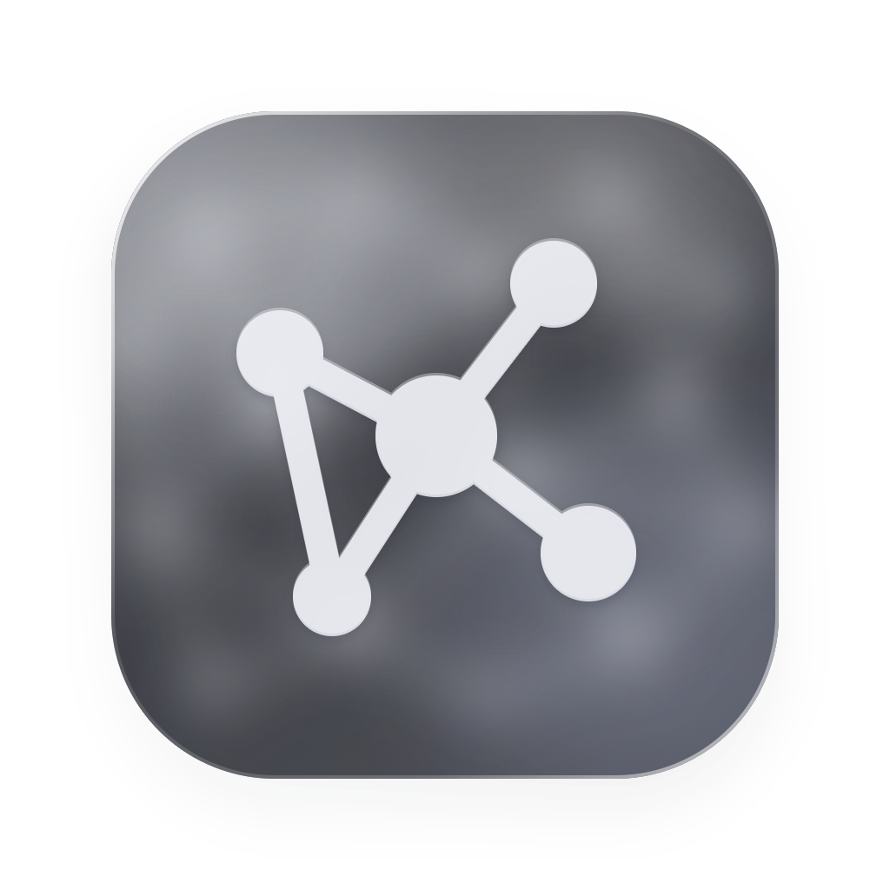

# Visual identity

[Русский](branding.ru.md) · [Documentation](README.md) · [Project](../README.md)



Aether's Constellation mark represents connected notes: a central thought, nearby ideas and links between them. The compact, asymmetric graph stays recognizable at small sizes.

The default workspace uses graphite in both light and dark mode. The base brand color is `#454752`; dark surfaces use lighter graphite accents for contrast. Custom palettes remain available. **Restore default palette** in Settings → Appearance returns to graphite. Code colors follow the graphite preset when **Match appearance** is selected with the default workspace.

The title bar uses the flat mark from `src/components/BrandMark.tsx`, colored by the current theme. The desktop and browser icon uses `src-tauri/icons/icon.svg`: a glass tile with a sharp foreground mark and a soft white background graph. Transparency, blur, highlights and a dark backing are contained in the icon; the application does not blur the user's desktop behind it.

`src-tauri/icons/icon.png` is the 1024-pixel macOS/source image. `src-tauri/icons/icon.ico` contains seven Windows sizes from 16 to 256 pixels. Both are generated from the SVG:

```powershell
node scripts/generate-app-icons.mjs
```

The renderer uses installed Microsoft Edge on Windows or Playwright Chromium on other systems. Inspect the generated files before committing. [Documentation screenshots](native-testing.md#reproduce-documentation-screenshots) use synthetic vaults and isolated application profiles.
