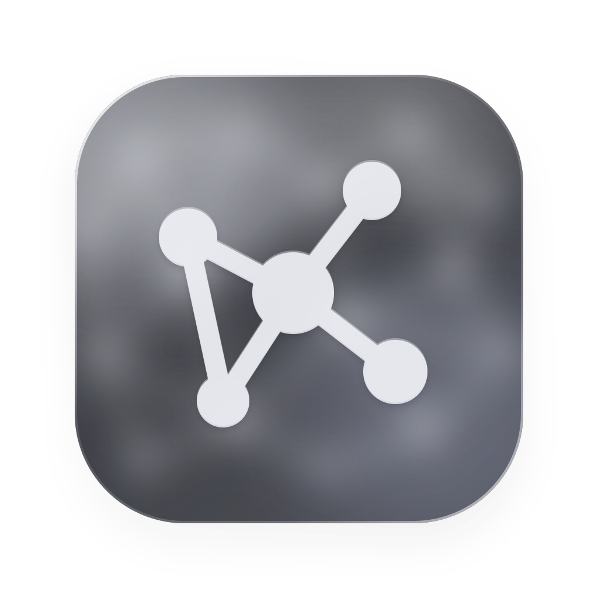

# Визуальное оформление

[English](branding.md) · [Документация](README.ru.md) · [Проект](../README.ru.md)



Знак «Созвездие» передаёт идею связанных заметок: центральная мысль, соседние идеи и связи между ними. Компактный асимметричный граф остаётся узнаваемым в небольшом размере.

Стандартное оформление — графитовое в светлой и тёмной темах. Основной цвет — `#454752`; на тёмных поверхностях используются светлые графитовые акценты для контраста. Пользовательские гаммы доступны по-прежнему. Кнопка **Вернуть стандартную гамму** в настройках оформления возвращает графитовую палитру. При стандартном оформлении и выборе **Как в оформлении** подсветка кода использует графитовый пресет.

В заголовке окна используется плоский знак из `src/components/BrandMark.tsx`, окрашенный текущей темой. Иконка приложения и браузера — `src-tauri/icons/icon.svg`: стеклянная плитка с чётким знаком и мягким белым графом позади него. Прозрачность, размытие, блики и тёмная подложка находятся внутри иконки; рабочий стол пользователя за ней приложение не размывает.

`src-tauri/icons/icon.png` — исходное изображение размером 1024 пикселя. `src-tauri/icons/icon.ico` содержит семь размеров Windows от 16 до 256 пикселей. macOS использует `src-tauri/icons/icon.icns`, созданный генератором Tauri со стандартными и Retina-размерами: упаковщик не конвертирует одиночный PNG размером 1024 пикселя напрямую. Все три файла создаются из SVG:

```powershell
node scripts/generate-app-icons.mjs
```

Для отрисовки используется установленный Microsoft Edge на Windows или Playwright Chromium на других системах. Проверьте изображения перед коммитом. [Снимки для документации](native-testing.ru.md#повторение-снимков-документации) создаются на синтетических хранилищах с отдельными профилями приложения.
