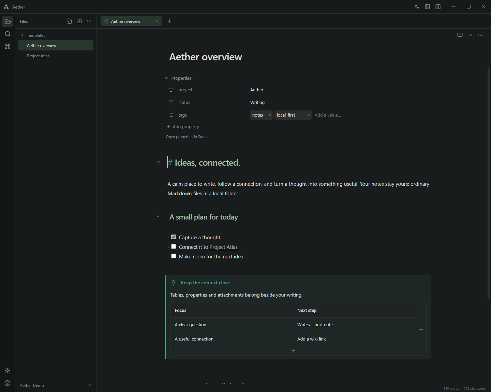
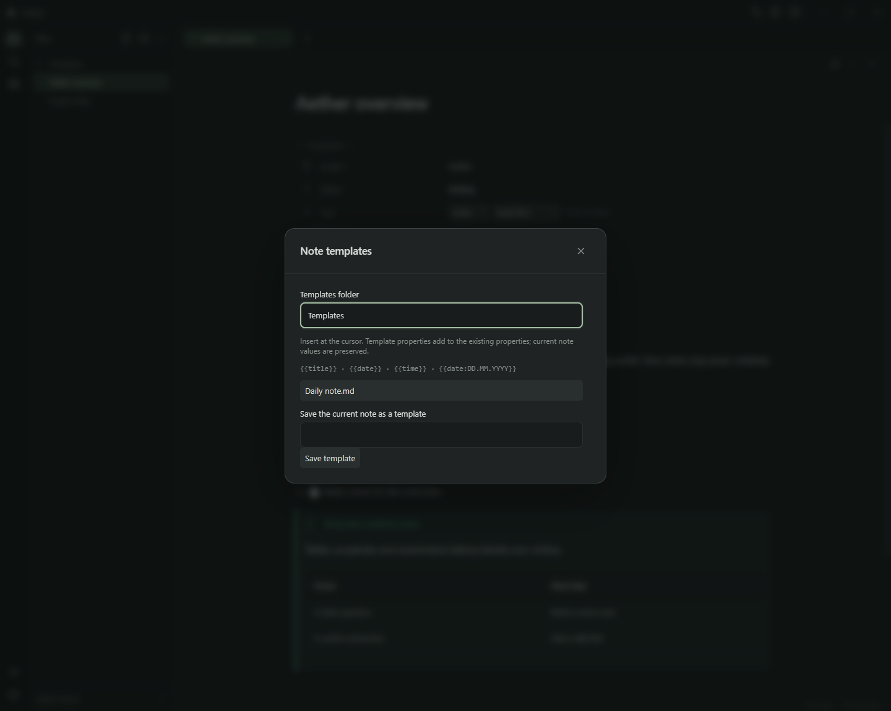
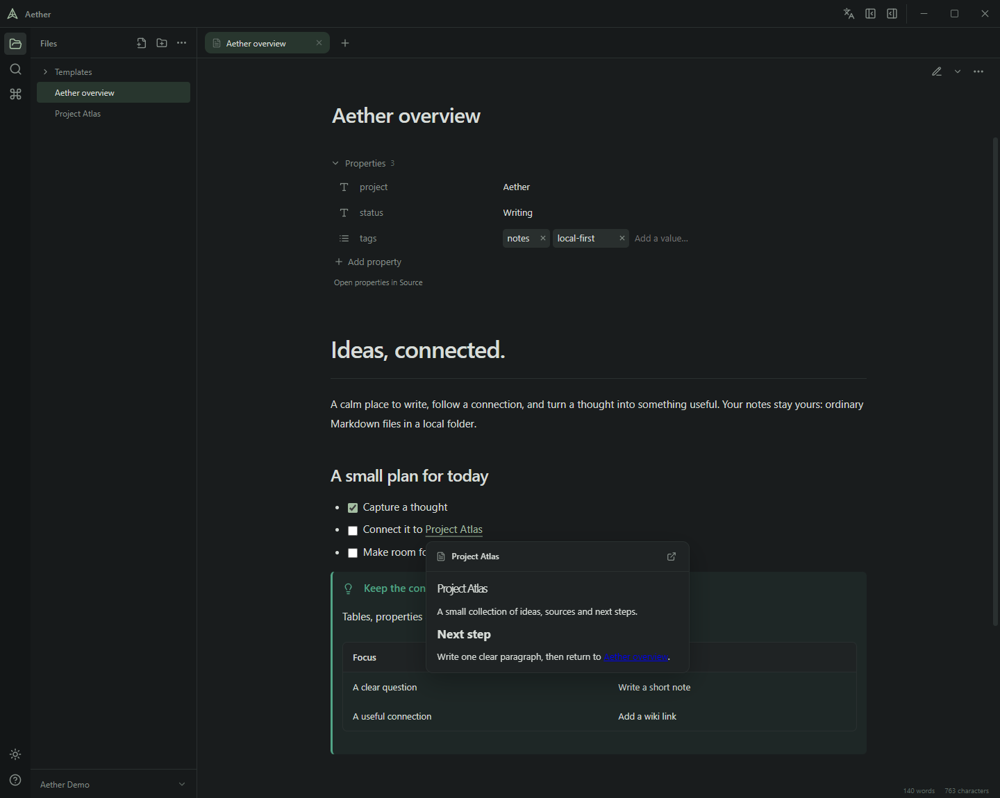

# Interface and Obsidian compatibility

[Русский](interface.ru.md) · [Documentation](README.md) · [Project](../README.md)

## Workspace and languages

The ribbon opens files, search and commands. Tabs and the note toolbar sit above the editor; the vault menu is below the file tree. The right sidebar contains relations and attachments. Properties appear in the note, not in a separate inspector editor.

Sidebars are resizable and collapsible; themes, line numbers and formatting controls are optional. Use the language icon near the window controls or the language command to switch English/Russian. The choice persists in `aether.ui.language`. It changes interface labels, dialogs, accessibility text and supported errors, never note content or filenames. A failed preference write is reported; the selected language remains usable for the current session.

## Writing and tables

Source and Live Preview share the editor state; Reading renders the current buffer. Formatting, templates and property/table edits use transactions so undo and unsaved text remain available. Supported headings and lists can be folded. The fold control sits between line numbers and text; collapsed content uses a plain ellipsis.

In tables, click a cell to edit its Markdown; unfocused cells show supported formatting. Use the bottom/right plus controls for rows/columns and right-click for context actions. Long text wraps inside the editor. Supported callout/list prefixes survive edits; ambiguous nested structures remain editable in Source.

## Properties and templates

YAML properties appear as rows with a type icon, name and value. Click the icon for text, number, checkbox, date, date/time or list types. Type assignments apply to the same property name across the vault through `.obsidian/types.json`. Assignments are explicit, revision checked and preserve unrelated settings; note text still requires Save. Add/rename fields inline, edit list chips and use catalog suggestions. Unsupported or mismatched YAML stays accessible in Source.

Templates use the folder in `.obsidian/templates.json`, or `Templates` when unset. Insertion supports title/date/time tokens, merges missing frontmatter fields and forms one undo step. Folder settings are read without modification.

## Links and media

Supported wiki/Markdown links resolve paths, aliases and heading/block targets through shared vault rules. Hover previews and embeds can use the current unsaved buffer of an open target. Ambiguous targets require a choice. Embeds preserve the linked note's origin for relative resources and have recursion limits.

Local images, PDF, audio and video have dedicated views. PDF supports text selection, search, password entry and read-only annotation text; it does not execute actions/forms. External images/direct media require explicit loading. Web pages open in the external browser. Passive HTML is reconstructed from an allowlist; scripts and arbitrary attributes are never mounted. Mermaid is sandboxed; KaTeX uses untrusted input restrictions.

## Compatibility boundaries

Ordinary Markdown and attachments stay portable. Aether respects supported Obsidian attachment-folder/link preferences and reads aliases, templates and shared property types. It does not implement Obsidian's plugin runtime, Canvas, Bases, sync or every Markdown extension. Complex YAML and unsupported table structures may require Source; there is no dedicated visual math/diagram editor. Compatibility means preserving usable files, not reproducing every Obsidian screen.

Original notes are saved explicitly. Recovery drafts, rename journals and local trash support recovery but do not replace backups.

## Graph view

Open **Graph view** from the left ribbon or command palette. The graph opens as a separate workspace tab; switching to a note keeps the graph and its controls available. Ctrl+W closes the active graph tab. Drag the canvas to pan, scroll to zoom around the pointer, and drag nodes to rearrange them. Click a node or focus it and press Enter to open its note. Hovering highlights its neighbors; more connected notes have larger nodes. The canvas also supports arrow keys and +/−. The fit control centers the visible graph in the viewport, and enabling a local graph centers its root note. The reset control restores default settings and rebuilds the clustered layout around highly connected notes.

Graph settings offer text/path filtering, orphan visibility, local depth (1–5), labels, node size, link thickness and center/repel/link forces. The graph uses saved indexed note links and the shared resolver, including aliases. It does not include unsaved links, missing targets, attachments or tag nodes. Closing the graph returns to the existing editor without replacing its buffer. Settings and positions are saved locally per vault.

Large graphs use batched Canvas drawing. Layout frames stop when the graph settles; resizing and theme changes redraw it without restarting the simulation. Initial layout preparation yields between batches. Restoring a partial layout preserves known positions and places new notes separately, including notes without links.

D3 Force handles link attraction, repulsion and size-aware collisions. Dragging temporarily fixes the selected node while its neighbours adjust; releasing it lets the layout settle. Use **Pin node** or **Unpin node** in its context menu for persistent placement. Hiding or closing the graph stops calculation and releases temporary drag locks.

The initial layout fills a disc with evenly spaced seeds. Louvain connectivity chooses local hubs; D3 then balances every link, repulsion, minimum node clearance and a soft circular boundary. Repeated and reciprocal links share one visual edge. Saved positions and explicit pins remain intact; reset rebuilds the layout. With labels enabled, no captions appear below a shared threshold of two screen pixels per graph unit; at or above it every visible note has a caption below its node. Text stays 11 screen pixels high and wraps to at most three lines in both SVG and Canvas. There is no per-caption collision filtering or hover exception. Further zoom spreads nodes apart without enlarging the text. Dense graphs and manually pinned positions can still produce crossing lines or overlapping captions.

Ordinary notes stay smaller than highly connected hubs. Collision spacing reserves extra clearance between neighbours, and high-degree hubs use longer link distances to accommodate their notes. Explicitly pinned positions can override that spacing.

## Settings

Open Settings from the gear at the bottom of the ribbon, the command palette, or Ctrl+, (Cmd+, on macOS). The modal groups language under General, theme under Appearance, and line numbers, line wrapping and formatting-toolbar visibility under Editor. Changes apply immediately and retain existing preference keys. Escape closes the window and returns focus to the previous control.

In Appearance, choose Light, Dark, or Follow system. Follow system updates when the operating system changes its color scheme.

Editor settings also provide font size (12–24 px), line height (1.2–2.4), text width (480–1100 px), a text sample and a reset action. Preferences apply to Source, Live Preview and Reading and persist for the profile. Keyboard shortcuts lists commands with a search by title or shortcut; assignments are read-only.

Appearance offers eight palette presets, a custom base color, and compact or comfortable interface density. Density adjusts spacing in the file tree, tabs, and menus. Both preferences persist for the profile.

Reorder note and image tabs by dragging or by pressing Alt+Shift+Left/Right on a focused tab. The order persists with the workspace while each tab keeps its unsaved content.

The graph tab participates in the shared tab order. Drag it, move it with Alt+Shift+Left/Right, or close it through its context menu or Ctrl+W. Its position restores separately for each vault.

Editor settings set the default mode for new tabs. Workspace settings select the startup note, recent files, link opening behavior, and the tab overflow menu. Opening a link in the current tab keeps tabs with unsaved drafts open. Attachment settings choose a folder inside the vault and Wiki or Markdown links, with an option to use Obsidian settings. Keyboard shortcuts can be reassigned for application and editor commands, checked for conflicts, and reset individually.
