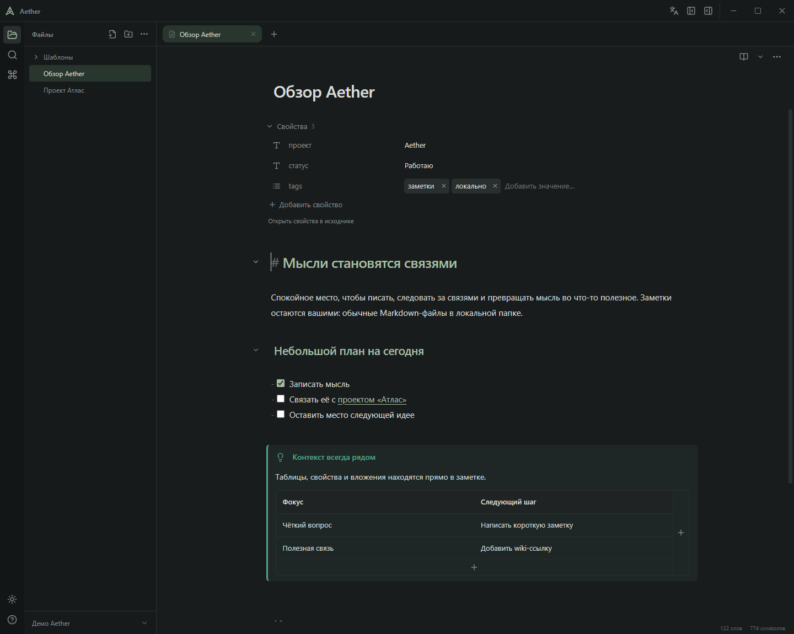
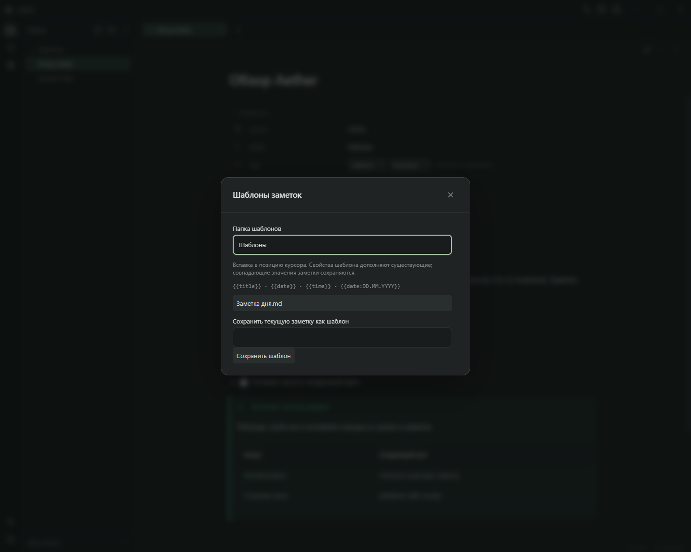
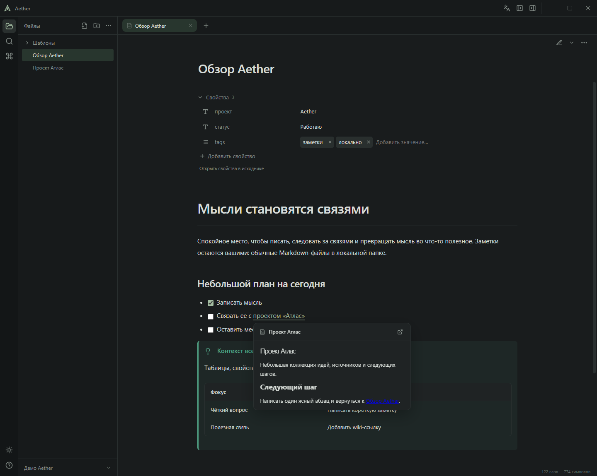

# Интерфейс и совместимость с Obsidian

[English](interface.md) · [Документация](README.ru.md) · [Проект](../README.ru.md)

## Рабочее пространство и языки

Вертикальная панель открывает файлы, поиск и команды. Вкладки и действия заметки находятся над редактором, меню хранилища — под деревом файлов. Правая панель показывает связи и вложения. Свойства расположены в заметке, а не в отдельном редакторе инспектора.

Боковые панели изменяют ширину и сворачиваются; темы, номера строк и форматирование настраиваются. Кнопка языка возле управления окном или команда языка переключает русский/английский. Выбор хранится в `aether.ui.language`. Переводятся подписи интерфейса, диалоги, доступность и поддерживаемые ошибки, но не содержимое заметок и имена файлов. Ошибка записи предпочтения показывается пользователю; выбранный язык работает до конца сеанса.

## Письмо и таблицы

Исходник и Live Preview используют общее состояние редактора; чтение отображает текущий буфер. Форматирование, шаблоны и правки свойств/таблиц применяются транзакциями, сохраняя отмену и несохранённый текст. Заголовки и поддерживаемые списки сворачиваются. Иконка находится между номерами строк и текстом; скрытый текст отмечается обычным многоточием.

Щелчок по ячейке открывает редактирование Markdown; вне фокуса видно поддерживаемое форматирование. Плюсики снизу/справа добавляют строки/столбцы, ПКМ открывает действия. Длинный текст переносится внутри редактора. Поддерживаемые префиксы выносок/списков сохраняются; неоднозначные вложенные структуры доступны в исходнике.

## Свойства и шаблоны

YAML-свойства показаны строками с иконкой типа, именем и значением. Иконка открывает типы: текст, число, флажок, дата, дата/время и список. Через `.obsidian/types.json` тип действует на одноимённое свойство во всём хранилище. Изменения явные, с проверкой ревизии и сохранением остальных настроек; текст заметки всё равно требует сохранения. Поля добавляются и переименовываются на месте, списки редактируются метками, доступны подсказки каталога. Неподдерживаемый YAML остаётся в исходнике.

Шаблоны используют папку из `.obsidian/templates.json` или `Templates`, если настройка отсутствует. Вставка поддерживает переменные заголовка/даты/времени, объединяет недостающие поля frontmatter и отменяется одним шагом. Настройка папки читается без изменения.

## Ссылки и медиа

Поддерживаемые wiki/Markdown-ссылки разрешают пути, псевдонимы и цели заголовков/блоков по общим правилам хранилища. Предпросмотр и встраивания могут использовать несохранённый буфер открытой заметки. Неоднозначная цель требует выбора. Встроенная заметка сохраняет свой контекст относительных ресурсов; рекурсия ограничена.

Локальные изображения, PDF, аудио и видео имеют собственное представление. PDF поддерживает выделение, поиск, пароль и чтение текста аннотаций, но не исполняет действия/формы. Внешние изображения и прямые медиа требуют явной загрузки. Веб-страницы открываются в браузере. Пассивный HTML восстанавливается по списку разрешённых элементов; скрипты и произвольные атрибуты не подключаются. Mermaid изолирован, KaTeX ограничивает недоверенный ввод.

## Границы совместимости

Markdown и вложения остаются переносимыми. Aether учитывает поддерживаемые настройки папки/ссылок вложений Obsidian, читает псевдонимы, шаблоны и общие типы свойств. Не реализованы среда плагинов Obsidian, Canvas, Bases, синхронизация и все расширения Markdown. Сложный YAML и неподдерживаемые таблицы могут требовать исходника; отдельного визуального редактора формул/диаграмм нет. Совместимость означает сохранение пригодных файлов, а не копирование каждого экрана Obsidian.

Оригиналы сохраняются явно. Черновики, журналы переименований и локальная корзина помогают восстановлению, но не заменяют резервные копии.

## Граф связей

Откройте **Граф связей** кнопкой на левой панели или через палитру команд. Граф открывается отдельной вкладкой: переключение к заметке сохраняет граф и его настройки. Ctrl+W закрывает активную вкладку графа. Перетаскивайте полотно для перемещения, вращайте колесо для масштабирования относительно указателя, перетаскивайте узлы для изменения раскладки. Нажмите узел или выберите его клавишей Tab и нажмите Enter, чтобы открыть заметку. При наведении подсвечиваются соседи; узлы с большим числом связей крупнее. Полотно также поддерживает стрелки и +/−. Кнопка вписывания центрирует видимый граф, а включение локального графа центрирует его корневую заметку. Кнопка сброса восстанавливает настройки и заново строит кластерную раскладку вокруг крупных заметок.

В настройках доступны поиск по названию и пути, показ заметок без связей, глубина локального графа (1–5), подписи, размер узлов, толщина линий и силы центра, отталкивания и связей. Граф использует сохранённые индексированные ссылки и общий механизм разрешения, включая псевдонимы. Несохранённые ссылки, отсутствующие заметки, вложения и узлы тегов пока не отображаются. Закрытие графа возвращает к существующему редактору без замены текста. Настройки и позиции сохраняются локально для каждого хранилища.

Большие графы используют групповую отрисовку Canvas. После остановки раскладки кадры расчёта прекращаются; изменение размеров и темы перерисовывает граф без перезапуска симуляции. Подготовка начальной раскладки выполняется порциями. При частичном восстановлении известные позиции сохраняются, а новые заметки размещаются отдельно, включая заметки без связей.

D3 Force рассчитывает притяжение связей, отталкивание и столкновения с учётом размеров узлов. При перетаскивании выбранная заметка временно удерживается под указателем, а соседи перестраиваются. После отпускания раскладка затихает. Для постоянного положения используйте **Закрепить узел** или **Освободить узел** в контекстном меню. Скрытие и закрытие графа останавливают расчёт и снимают временные фиксации.

Начальная раскладка равномерно заполняет диск. Связность Louvain определяет локальные центры; затем D3 балансирует все связи, отталкивание, минимальные зазоры между узлами и мягкую круглую границу. Повторные и взаимные ссылки отображаются одной линией. Сохранённые позиции и явные закрепления остаются на месте; сброс перестраивает раскладку. При включённых названиях до общего порога в два экранных пикселя на единицу графа подписей нет; начиная с порога каждая видимая заметка получает подпись под точкой. Шрифт сохраняет размер 11 экранных пикселей и переносится максимум на три строки в SVG и Canvas. Отбора отдельных подписей по пересечениям и исключения при наведении нет. Дальнейшее приближение увеличивает расстояния между точками без увеличения текста. В плотном графе и при ручных закреплениях возможны пересечения линий и наложения подписей.

Обычные заметки остаются меньше крупных узлов-центров. При расчёте столкновений между соседями оставляется дополнительный зазор, а центры с большим числом связей получают более длинные связи для размещения заметок. Явно закреплённые позиции могут нарушать эти расстояния.

## Настройки

Откройте настройки шестерёнкой внизу левой панели, через палитру команд или Ctrl+, (Cmd+, на macOS). В разделе «Общие» находится язык, в «Оформлении» — тема, в «Редакторе» — номера строк, перенос строк и видимость панели форматирования. Изменения применяются сразу с сохранением прежних ключей настроек. Escape закрывает окно и возвращает фокус к предыдущему элементу.

В настройках редактора доступны размер шрифта (12–24 пикселя), межстрочный интервал (1,2–2,4), ширина текста (480–1100 пикселей), пример текста и сброс параметров. Настройки действуют в Source, Live Preview и режиме чтения и сохраняются для профиля. Раздел «Горячие клавиши» показывает команды с поиском по названию или сочетанию; переназначение недоступно.
