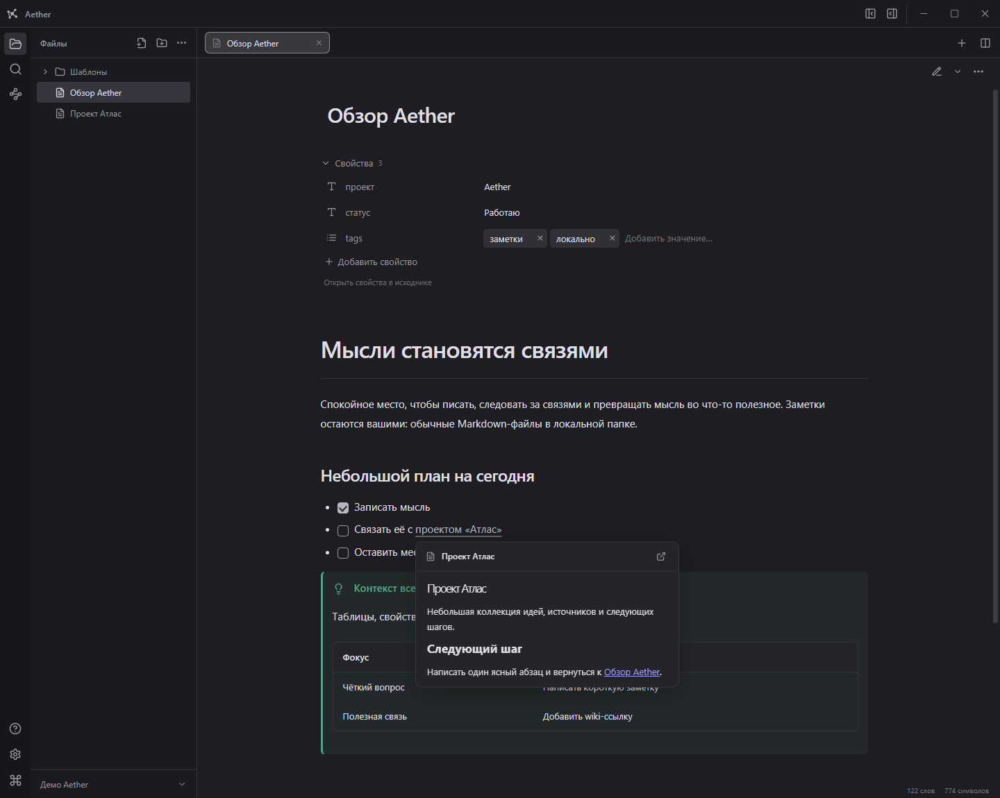

# Нативные проверки и снимки

[English](native-testing.md) · [Документация](README.ru.md) · [Проект](../README.ru.md)

## Изолированная Windows-среда

Нативные тесты используют release-сборку с необязательной функцией `e2e`, отдельным идентификатором приложения, явной папкой тестовых данных и собственным профилем WebView2. Playwright подключается через локальный CDP; дополнительный Chromium не нужен. Обычные сборки не разрешают тестовую подмену папки данных.

Harness создаёт демонстрационные хранилища в игнорируемой `.build-cache/`, управляет скрытым дочерним WebView и останавливает только собственные процессы. Он не вводит текст в пользовательское окно и не проверяет личные хранилища. Артефакты остаются для диагностики; рекурсивного удаления тестовых папок нет.

## Запуск

```powershell
npm ci
npm run build:e2e
npm run test:e2e
```

После изменений frontend/host пересоберите тестовую версию. Необязательный кеш реестра описан в [руководстве разработчика](../CONTRIBUTING.ru.md#необязательный-транспорт-cargo). Отчёт: `.build-cache/native-results/report.json`; артефакты: `.build-cache/native-results/artifacts/`.

Выборочная проверка языка и редактора:

```powershell
npm run test:e2e -- --grep 'settings preserve|writing workflows:|editor compatibility:|note properties:'
```

Тест языка проверяет сохранение DOM редактора, неизменность пользовательского текста, отмену/повтор, явное сохранение и язык после перезапуска. Другие сценарии покрывают черновики, ревизии, восстановление переименования, навигацию, таблицы/свойства, шаблоны и встроенные материалы. Нативные тесты не измеряют перетаскивание окна, FPS или память.

## Повторение снимков документации

После сборки тестового приложения:

```powershell
$env:AETHER_DOC_SCREENSHOTS = '1'
npm run test:e2e -- --grep 'documentation screenshots'
Remove-Item Env:AETHER_DOC_SCREENSHOTS
```

Эти явные сценарии создают отдельные EN/RU-хранилища, переключают настоящий язык интерфейса и сохраняют `workspace-dark.png`, `workspace-light.png`, `link-preview.png`, `templates.png` и `appearance.png` в `docs/screenshots/en/` и `ru/`. В видимом тексте проверяется отсутствие абсолютных домашних путей, текущих имён аккаунта и компьютера; на английских экранах — отсутствие русского текста. Исходные заметки должны оставаться неизменными. Перед публикацией осмотрите каждое изображение на обоих языках и в обеих темах, включая подсказки и диалоги. Снимки являются документационными ресурсами, а не экспортом личных хранилищ. Не используйте личное хранилище или обычный профиль пользователя для съёмки.


